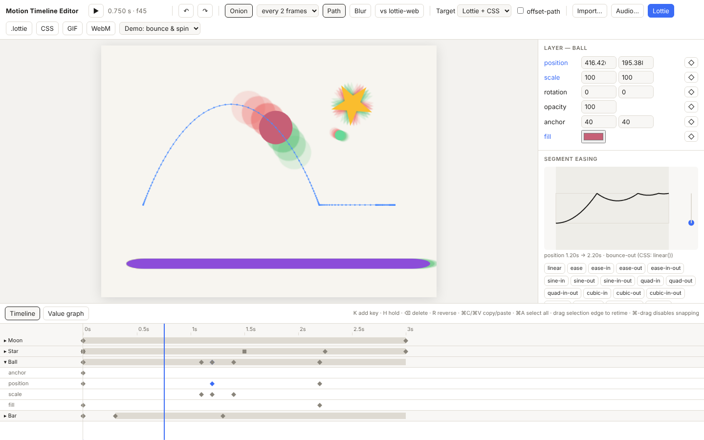

# Motion Timeline Editor

A keyframe editor with editable bezier easing, onion skinning, and export to
**Lottie** and **CSS**. Every export is preceded by an honest analysis of what
each target can and can't represent.



## What's in v1

- **Lottie-shaped model.** Time is stored in seconds. Each property is its own channel, with per-keyframe in/out easing (per-dimension allowed), spatial bezier motion paths, holds, accumulating rotation, OKLab colour, parenting and rotate-then-translate orbits.
- **Browser-matched easing.** Newton–Raphson with a bisection fallback, plus a sample-table cache. Across 756 curves it differs from the browser's own `cubic-bezier()` by at most **5.3 × 10⁻⁶** (budget 10⁻⁴).
- **Canvas preview.** Onion skins (by frame or by keyframe, cached, half resolution, off during playback), a motion-path overlay, and motion blur. A 3+3 onion scrub on 50 layers stays inside 60 fps.
- **Lottie export.** Shape and null layers, per-dimension easing, spatial tangents and holds, with warnings for keyframes between frames. Exports also come as `.lottie`. Checked pixel by pixel against **lottie-web**.
- **CSS export.** Individual `translate`/`rotate`/`scale` properties. Easing becomes `cubic-bezier()` where possible and adaptive `linear()` for bounce, elastic and spring. Curved paths are baked to tolerance, or exported exactly with `offset-path`; orbits use wrapper elements. Checked pixel by pixel through the Web Animations API.
- **Export analysis.** Live, per property: exact, approximated, baked (with keyframe count and maximum deviation) or unrepresentable, driven by the [capability matrix](1—Documentation/v1/export-matrix.md).
- **Canvas timeline.** Virtualised, with hit testing, snapping (with a visible snap line), marquee and shift selection, retiming by dragging a selection's edge, reverse, copy/paste, and undo where a whole drag is one step.
- **Curve editors.** A segment editor with target-aware handle limits, a preset library that marks which curves need `linear()`, and an animated replay dot. There's also a value graph with tangent handles.
- **Import.** Lottie (`.json`, `.lottie`) with clear errors for anything outside the subset, and SVG shapes as layers.
- **Extras.** Spring easing, drivers, GIF and WebM export, an audio waveform track and motion blur. See [stretch goals](1—Documentation/v1/stretch-goals.md).

## Quick start

```bash
cd v1
npm install
npm run dev                 # the editor at http://localhost:5173
npm run export              # demo scene → out/export/animation.{json,lottie,html}, with the analysis
```

## Checks

```bash
npm run typecheck
npm test                    # unit tests: solver, model, exporters, import round-trip, timeline, history
npm run test:browser        # easing vs WAAPI, preview vs lottie-web vs CSS (pixels), performance budgets
```

`test:browser` needs Playwright and its browsers (`npx playwright install`). It runs in every browser that's installed; CI runs Chromium, Firefox and WebKit.

## Documentation

All documentation lives in [`1—Documentation/`](1—Documentation/README.md):

- [design & build guide](1—Documentation/design-guide.md)
- [export capability matrix](1—Documentation/v1/export-matrix.md)
- [Lottie subset](1—Documentation/v1/lottie-subset.md)
- [easing evaluation](1—Documentation/v1/easing.md)
- [using the editor](1—Documentation/v1/editor.md)

## Licence

[MIT](LICENSE). Dependencies: lottie-web (MIT), gifenc (MIT), fflate (MIT).
